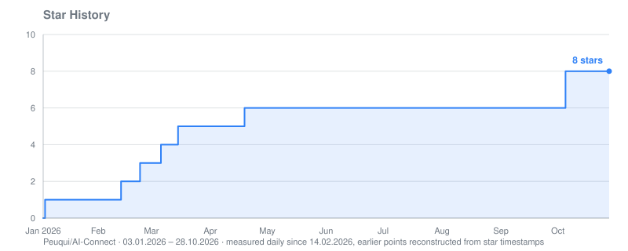
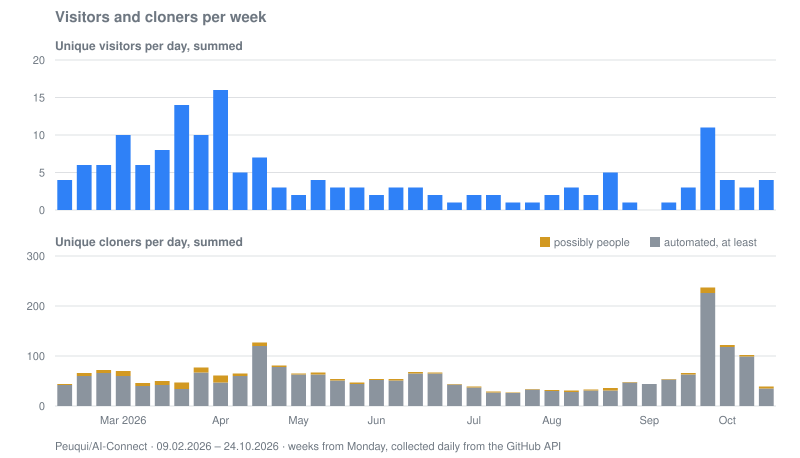

# AI-Connect

[Repository](https://github.com/Peuqui/AI-Connect) · [all repositories](../../README.md)

## Where visitors came from

Views from each referring site in the 14 days up to the date, newest first. Days without a snapshot
leave a gap.

| Site | 30.10.2026 | 16.10.2026 | 02.10.2026 | 18.09.2026 | 04.09.2026 | 21.08.2026 | 07.08.2026 | 24.07.2026 | 10.07.2026 | 26.06.2026 | 12.06.2026 | 29.05.2026 | 15.05.2026 |
|---|---:|---:|---:|---:|---:|---:|---:|---:|---:|---:|---:|---:|---:|
| reddit.com | 2 | 6 | 2 |  | 4 | 3 |  | 3 | 1 | 5 | 3 | 7 | 4 |
| Google | 1 | 1 | 1 |  | 2 |  |  |  |  |  | 1 |  | 1 |
| github.com | 2 |  |  |  |  |  | 1 |  |  |  |  |  | 1 |
| com.reddit.frontpage |  | 1 |  |  |  |  |  |  |  |  |  |  |  |
| pulsemcp.com |  |  |  |  |  |  |  |  |  |  |  |  | 1 |
| DuckDuckGo |  |  |  |  |  |  | 1 |  |  |  |  |  |  |
