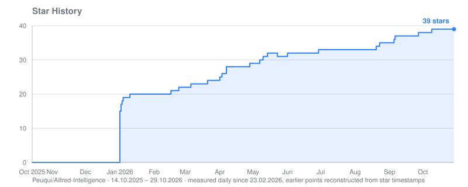
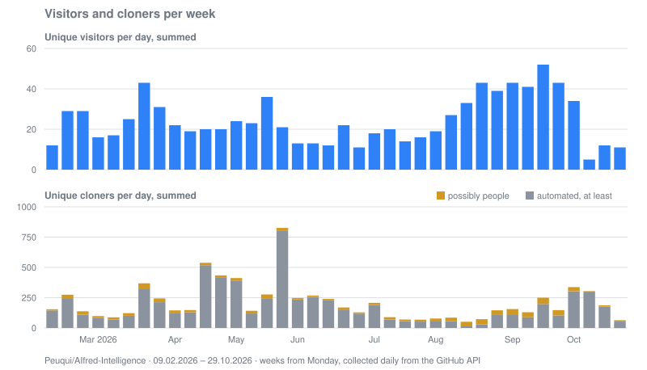

# AIfred-Intelligence

[Repository](https://github.com/Peuqui/AIfred-Intelligence) · [all repositories](../../README.md)

## Where visitors came from

Views from each referring site in the 14 days up to the date, newest first. Days without a snapshot
leave a gap.

| Site | 29.10.2026 | 15.10.2026 | 01.10.2026 | 17.09.2026 | 03.09.2026 | 20.08.2026 | 06.08.2026 | 23.07.2026 | 09.07.2026 | 25.06.2026 | 11.06.2026 | 28.05.2026 | 14.05.2026 |
|---|---:|---:|---:|---:|---:|---:|---:|---:|---:|---:|---:|---:|---:|
| github.com | 1 | 11 | 14 | 21 | 35 | 8 | 9 | 14 | 20 | 6 | 13 | 28 | 13 |
| reddit.com | 1 | 7 | 9 | 3 | 4 | 1 | 1 | 3 |  | 1 | 3 | 5 | 2 |
| Google | 1 |  | 3 |  | 5 |  | 2 | 1 |  | 2 | 5 | 5 | 2 |
| chatgpt.com |  |  |  | 1 | 11 | 3 |  |  |  |  |  |  |  |
| gathering.tweakers.net |  | 2 | 3 |  |  |  |  |  |  |  |  |  |  |
| search.brave.com |  |  |  |  |  |  |  |  |  | 2 |  |  |  |
| doubao.com |  |  |  |  | 2 |  |  |  |  |  |  |  |  |
| teams.public.onecdn.static.microsoft |  |  |  | 1 |  |  |  |  |  |  |  |  |  |
| perplexity.ai |  |  |  | 1 |  |  |  |  |  |  |  |  |  |
| yandex.ru |  |  |  |  |  | 1 |  |  |  |  |  |  |  |
| aocr.org | 1 |  |  |  |  |  |  |  |  |  |  |  |  |
