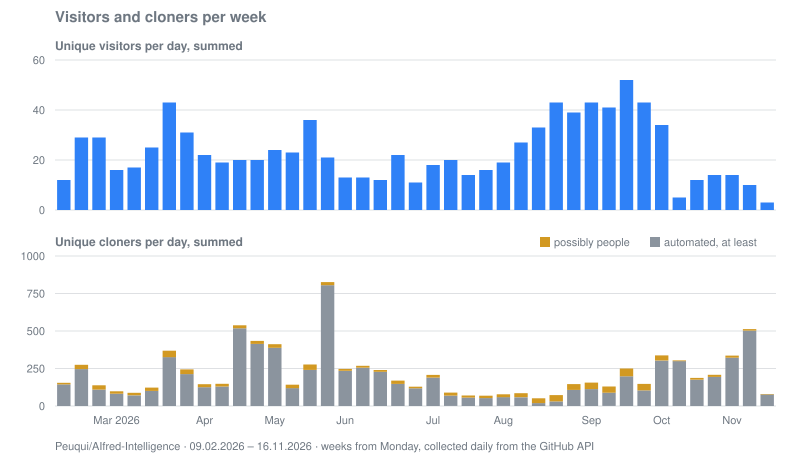

# AIfred-Intelligence

[Repository](https://github.com/Peuqui/AIfred-Intelligence) · [all repositories](../../README.md)

## Where visitors came from

Views from each referring site in the 14 days up to the date, newest first. Days without a snapshot
leave a gap.

| Site | 15.11.2026 | 01.11.2026 | 18.10.2026 | 04.10.2026 | 20.09.2026 | 06.09.2026 | 23.08.2026 | 09.08.2026 | 26.07.2026 | 12.07.2026 | 28.06.2026 | 14.06.2026 | 31.05.2026 |
|---|---:|---:|---:|---:|---:|---:|---:|---:|---:|---:|---:|---:|---:|
| github.com | 6 | 2 | 10 | 15 | 17 | 34 | 13 | 10 | 10 | 23 | 6 | 15 | 24 |
| reddit.com | 3 | 1 | 4 | 10 | 3 | 4 | 1 |  | 2 | 2 | 1 | 3 | 2 |
| Google |  | 1 |  | 2 | 1 | 5 |  | 2 | 1 |  | 2 |  | 10 |
| chatgpt.com |  |  |  |  | 1 | 3 | 11 |  |  |  |  |  |  |
| gathering.tweakers.net |  |  | 2 | 3 |  |  |  |  |  |  |  |  |  |
| aocr.org | 1 | 1 |  |  |  |  |  |  |  |  |  |  |  |
| doubao.com |  |  |  |  |  | 2 |  |  |  |  |  |  |  |
| search.brave.com |  |  |  |  |  |  |  |  |  |  | 2 |  |  |
| yandex.ru |  |  |  |  |  |  | 1 |  |  |  |  |  |  |
| perplexity.ai |  |  |  |  | 1 |  |  |  |  |  |  |  |  |
| teams.public.onecdn.static.microsoft |  |  |  |  | 1 |  |  |  |  |  |  |  |  |
