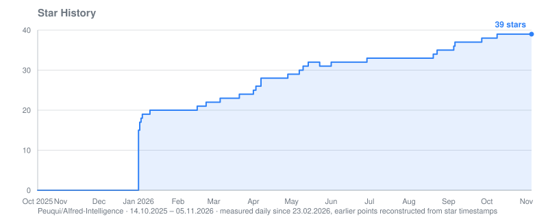
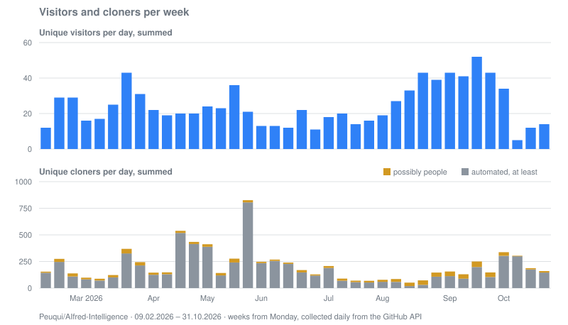

# AIfred-Intelligence

[Repository](https://github.com/Peuqui/AIfred-Intelligence) · [all repositories](../../README.md)

## Where visitors came from

Views from each referring site in the 14 days up to the date, newest first. Days without a snapshot
leave a gap.

| Site | 07.11.2026 | 24.10.2026 | 10.10.2026 | 26.09.2026 | 12.09.2026 | 29.08.2026 | 15.08.2026 | 01.08.2026 | 18.07.2026 | 04.07.2026 | 20.06.2026 | 06.06.2026 | 23.05.2026 |
|---|---:|---:|---:|---:|---:|---:|---:|---:|---:|---:|---:|---:|---:|
| github.com | 4 | 4 | 17 | 15 | 26 | 24 | 10 | 10 | 18 | 13 | 11 | 12 | 31 |
| reddit.com | 2 |  | 11 | 5 | 1 | 5 |  | 1 | 3 |  | 1 | 4 | 6 |
| Google |  | 1 | 2 | 1 | 4 | 1 | 1 | 2 |  | 1 | 1 | 9 | 1 |
| chatgpt.com |  |  |  | 1 | 1 | 12 | 2 |  |  |  |  |  |  |
| gathering.tweakers.net |  |  | 4 | 1 |  |  |  |  |  |  |  |  |  |
| perplexity.ai |  |  |  | 1 | 1 |  |  |  |  |  |  |  |  |
| aocr.org | 2 |  |  |  |  |  |  |  |  |  |  |  |  |
| search.brave.com |  |  |  |  |  |  |  |  |  | 2 |  |  |  |
| doubao.com |  |  |  |  |  | 2 |  |  |  |  |  |  |  |
| yandex.ru |  |  |  |  |  | 1 |  |  |  |  |  |  |  |
| teams.public.onecdn.static.microsoft |  |  |  | 1 |  |  |  |  |  |  |  |  |  |
