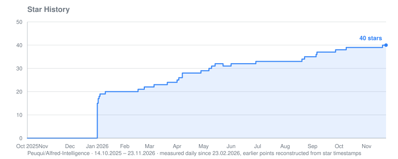

# AIfred-Intelligence

[Repository](https://github.com/Peuqui/AIfred-Intelligence) · [all repositories](../../README.md)

## Where visitors came from

Views from each referring site in the 14 days up to the date, newest first. Days without a snapshot
leave a gap.

| Site | 18.11.2026 | 04.11.2026 | 21.10.2026 | 07.10.2026 | 23.09.2026 | 09.09.2026 | 26.08.2026 | 12.08.2026 | 29.07.2026 | 15.07.2026 | 01.07.2026 | 17.06.2026 | 03.06.2026 |
|---|---:|---:|---:|---:|---:|---:|---:|---:|---:|---:|---:|---:|---:|
| github.com | 6 | 3 | 9 | 15 | 14 | 36 | 13 | 10 | 10 | 18 | 10 | 13 | 11 |
| reddit.com | 4 | 2 | 1 | 13 | 4 | 1 | 4 |  | 2 | 2 | 1 | 1 | 4 |
| Google | 1 |  | 1 | 2 | 1 | 5 |  | 2 | 1 |  | 2 |  | 9 |
| chatgpt.com |  |  |  |  | 1 | 2 | 10 | 2 |  |  |  |  |  |
| gathering.tweakers.net |  |  |  | 4 | 1 |  |  |  |  |  |  |  |  |
| aocr.org | 1 | 1 |  |  |  |  |  |  |  |  |  |  |  |
| search.brave.com |  |  |  |  |  |  |  |  |  |  | 2 |  |  |
| doubao.com |  |  |  |  |  |  | 2 |  |  |  |  |  |  |
| yandex.ru |  |  |  |  |  |  | 1 |  |  |  |  |  |  |
| teams.public.onecdn.static.microsoft |  |  |  |  | 1 |  |  |  |  |  |  |  |  |
| Bing | 1 |  |  |  |  |  |  |  |  |  |  |  |  |
| perplexity.ai |  |  |  |  | 1 |  |  |  |  |  |  |  |  |
