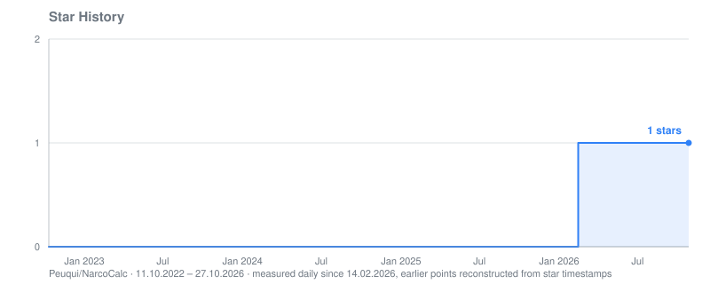
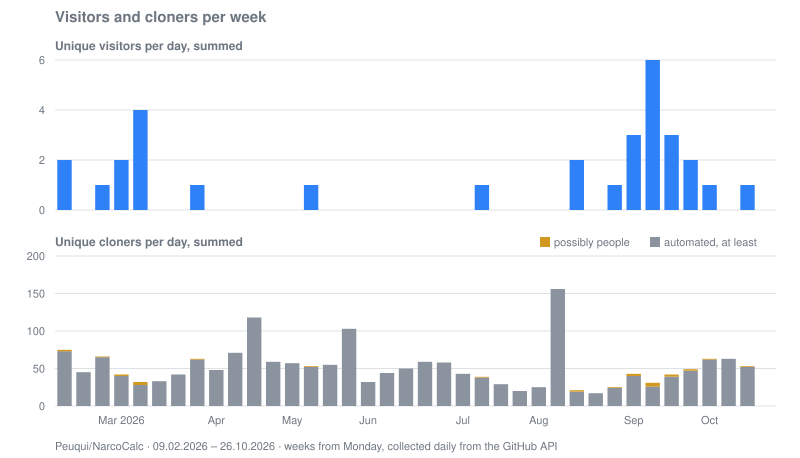

# NarcoCalc

[Repository](https://github.com/Peuqui/NarcoCalc) · [all repositories](../../README.md)

## Where visitors came from

Views from each referring site in the 14 days up to the date, newest first. Days without a snapshot
leave a gap.

| Site | 28.10.2026 | 14.10.2026 | 30.09.2026 | 16.09.2026 | 02.09.2026 | 19.08.2026 | 05.08.2026 | 22.07.2026 | 08.07.2026 | 24.06.2026 | 10.06.2026 | 27.05.2026 | 13.05.2026 |
|---|---:|---:|---:|---:|---:|---:|---:|---:|---:|---:|---:|---:|---:|
| github.com |  |  | 3 | 1 | 10 | 13 |  | 1 |  |  |  |  |  |
| Google |  |  |  | 1 | 1 |  |  |  |  |  |  |  |  |
| peuqui.github.io |  |  | 1 |  |  |  |  |  |  |  |  |  |  |
