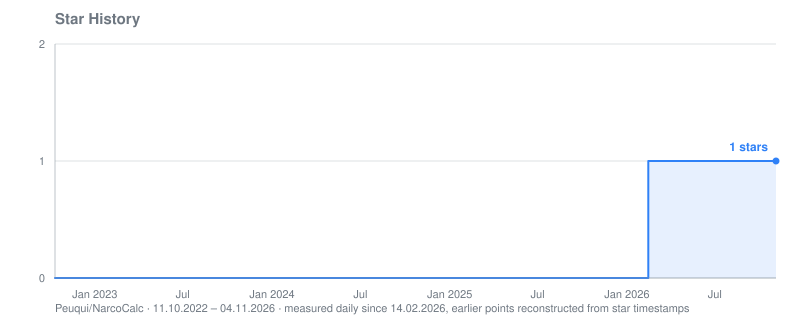
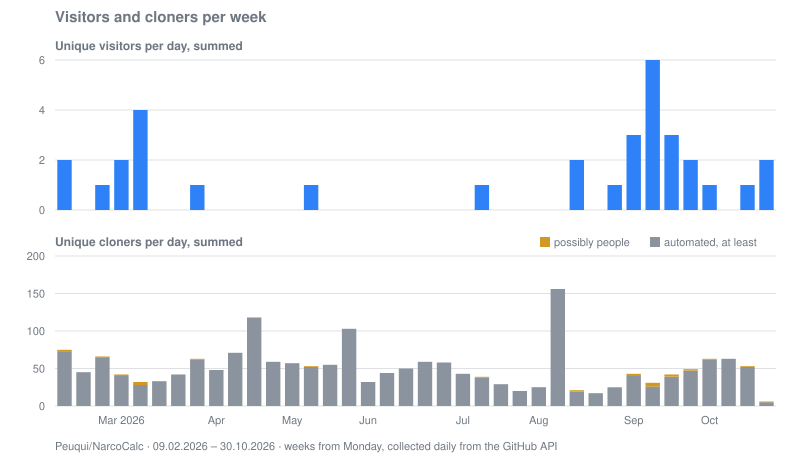

# NarcoCalc

[Repository](https://github.com/Peuqui/NarcoCalc) · [all repositories](../../README.md)

## Where visitors came from

Views from each referring site in the 14 days up to the date, newest first. Days without a snapshot
leave a gap.

| Site | 07.11.2026 | 24.10.2026 | 10.10.2026 | 26.09.2026 | 12.09.2026 | 29.08.2026 | 15.08.2026 | 01.08.2026 | 18.07.2026 | 04.07.2026 | 20.06.2026 | 06.06.2026 | 23.05.2026 |
|---|---:|---:|---:|---:|---:|---:|---:|---:|---:|---:|---:|---:|---:|
| github.com |  |  |  | 4 |  | 23 |  | 1 |  |  |  |  |  |
| peuqui.github.io |  |  |  | 1 |  |  |  |  |  |  |  |  |  |
| Google |  |  |  |  | 1 |  |  |  |  |  |  |  |  |
